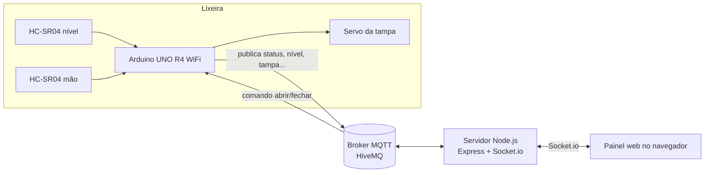

# SmartBin ESEG – Lixeira Inteligente IoT

Projeto acadêmico em grupo desenvolvido na ESEG: uma lixeira inteligente construída com **Arduino UNO R4 WiFi** que abre a tampa sozinha ao detectar a aproximação da mão e mede o nível de ocupação do lixo. Os dados são publicados via **MQTT** e exibidos em tempo real em um painel web feito com **Node.js, Express e Socket.io**, que também permite abrir e fechar a tampa remotamente.

## Tecnologias


- **Hardware:** Arduino UNO R4 WiFi, 2 sensores ultrassônicos HC-SR04 e 1 servo motor
- **Firmware:** C++ (Arduino) com as bibliotecas `WiFiS3`, `PubSubClient` e `Servo`
- **Comunicação:** MQTT no broker público HiveMQ (`broker.hivemq.com:1883`)
- **Servidor:** Node.js, Express, Socket.io e `mqtt`
- **Painel:** HTML, CSS e JavaScript com gráfico em Chart.js
- **Simulação do circuito:** Wokwi (`documentacao/wokwi/diagram.json`)

## Funcionalidades

**Na lixeira (Arduino)**
- Abertura automática da tampa quando a mão chega a menos de 15 cm do sensor externo; a tampa fecha sozinha 4 segundos depois que a mão sai.
- Medição do nível de lixo pelo sensor interno, convertida em porcentagem de ocupação (0 a 100%).
- Classificação do estado em `vazia`, `normal` ou `cheia`, com histerese e confirmação por leituras consecutivas para evitar oscilação por ruído.
- Média móvel na leitura de distância e publicação apenas quando o nível muda de forma relevante, com heartbeat periódico.
- Contador de aberturas da tampa desde que a placa foi ligada.
- Reconexão automática ao Wi-Fi e ao broker MQTT, sem travar a leitura dos sensores.
- *Last Will* do MQTT: se a placa cair, o próprio broker publica `offline`.
- Recebe comandos remotos `abrir` / `fechar` enviados pelo painel.

**No painel web**
- Nível atual, estado (vazia / normal / cheia), distância medida, estado da tampa e número de aberturas.
- Gráfico do histórico de nível (últimas 2 horas, mantido em memória no servidor).
- Indicador de lixeira online/offline e horário da última abertura.
- Botões para abrir e fechar a tampa à distância.
- Quem abre a página recebe imediatamente o último estado conhecido.

**Ferramentas de teste**
- `simulador.js` imita o Arduino publicando nos mesmos tópicos, para testar o painel sem a placa.
- `test-broker.js` verifica a conexão com o broker MQTT.

## Arquitetura



### Tópicos MQTT

Prefixo: `eseg/lixeira/juan-caua-bruno/`

| Tópico | Publica | Assina | Mensagem | Retain |
|---|---|---|---|---|
| `status` | Arduino | Servidor | `vazia` / `normal` / `cheia` | sim |
| `nivel` | Arduino | Servidor | `0` a `100` (% ocupado) | sim |
| `distancia` | Arduino | Servidor | cm do sensor até o lixo (ex.: `18.4`) | sim |
| `tampa` | Arduino | Servidor | `aberta` / `fechada` | sim |
| `aberturas` | Arduino | Servidor | nº de aberturas desde que ligou | sim |
| `online` | Arduino (e o broker, via Last Will) | Servidor | `online` / `offline` | sim |
| `comando` | Servidor (botões do site) | Arduino | `abrir` / `fechar` | não |

### Ligações do hardware

| Componente | Pinos |
|---|---|
| Sensor de nível (dentro da caixa) | TRIG 5 / ECHO 7 |
| Sensor de mão (fora da caixa) | TRIG 2 / ECHO 3 |
| Servo da tampa | 9 (PWM) |

## Como executar

### Painel web

Pré-requisito: [Node.js](https://nodejs.org/) instalado.

```bash
cd site-node
npm install
npm start
```

Abra http://localhost:3000.

Variáveis de ambiente opcionais:

| Variável | Padrão | Uso |
|---|---|---|
| `PORT` | `3000` | Porta do servidor HTTP |
| `MQTT_URL` | `mqtt://broker.hivemq.com:1883` | Endereço do broker MQTT |
| `LIXEIRA_PREFIXO` | `eseg/lixeira/juan-caua-bruno/` | Prefixo dos tópicos (útil para testar sem afetar a lixeira real) |

### Testar sem o Arduino

Com a placa **desligada**, rode o simulador em outro terminal:

```bash
cd site-node
npm run simulador
```

Para apenas testar a conexão com o broker: `npm run teste-broker`.

### Arduino

1. Abra `lixeira-arduino/lixeira-arduino.ino` na Arduino IDE e instale a biblioteca **PubSubClient** (as bibliotecas `WiFiS3` e `Servo` acompanham o pacote da placa UNO R4).
2. Preencha `ssid` e `password` com os dados da sua rede Wi-Fi (não publique sua senha real).
3. Meça com uma régua a distância do sensor de nível até o fundo da caixa vazia e ajuste `DIST_VAZIA`; os demais limites se adaptam a esse valor.
4. Grave o código na placa.

O circuito também pode ser aberto no [Wokwi](https://wokwi.com/) a partir de `documentacao/wokwi/diagram.json`.

## Estrutura do projeto

```
Projeto-Lixeira-IoT/
├── documentacao/
│   ├── Documentacao-SmartBin-ESEG.docx   # documentação do projeto
│   ├── fontes/                           # diagrama de blocos e gerador do .docx
│   ├── imagens/diagrama-blocos.png
│   └── wokwi/diagram.json                # circuito para simulação
├── lixeira-arduino/
│   └── lixeira-arduino.ino               # firmware da lixeira
└── site-node/
    ├── server.js                         # ponte MQTT <-> Socket.io + servidor web
    ├── simulador.js                      # simula a lixeira sem a placa
    ├── test-broker.js                    # teste de conexão com o broker
    └── public/index.html                 # painel web
```

## Equipe

- Juan
- Cauã
- Bruno Spinelli — [GitHub](https://github.com/brunospinelli08)

## Licença

Este projeto está sob a licença MIT. Veja o arquivo [LICENSE](LICENSE).
